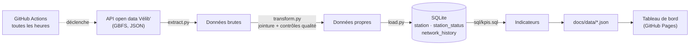
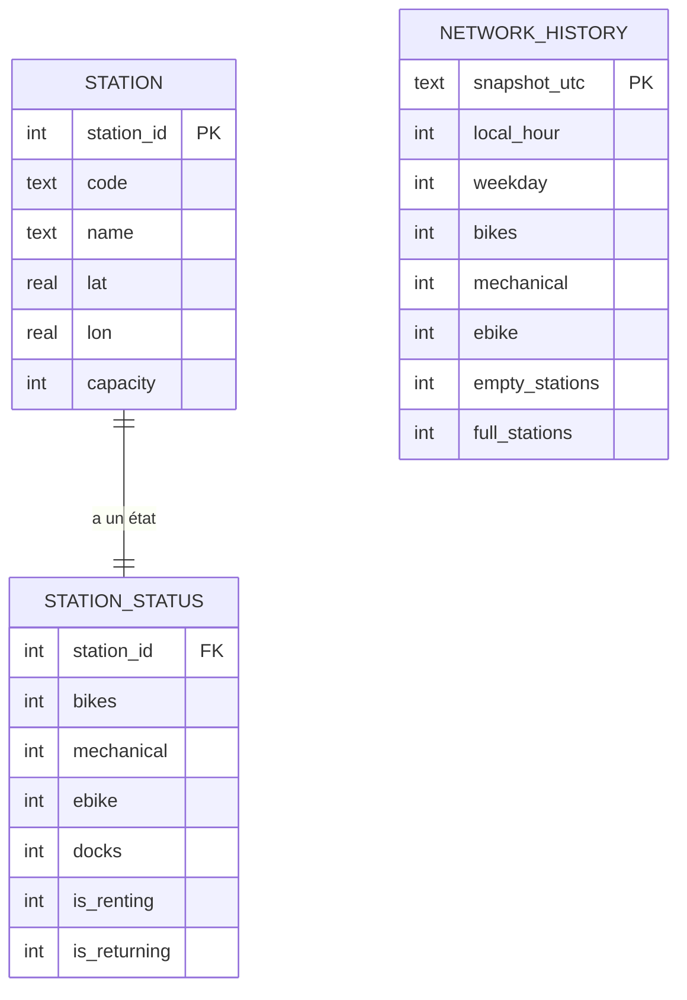

# Vélib' Métropole — pipeline de données en temps réel

**Tableau de bord en ligne : https://sarr-fatou.github.io/velib-pipeline/**

Projet de Data Engineering réalisé par [Fatou Sarr](https://sarr-fatou.github.io/) (Master 1 MIAGE — Data, IA & Big Data).

Un pipeline **ETL** (Extract, Transform, Load) automatisé collecte **toutes les heures** l'état des ~1 500 stations Vélib' de la Métropole du Grand Paris à partir des **données ouvertes** de l'opérateur, contrôle la qualité des données, les charge dans une base **SQL**, calcule des indicateurs et publie un tableau de bord.

## Objectifs

- Construire un pipeline de données **de bout en bout**, de l'API source jusqu'à la visualisation.
- **Automatiser** la collecte sans serveur, avec GitHub Actions.
- Mettre en place des **contrôles qualité** et des **tests unitaires**.
- Calculer les indicateurs métier en **SQL**.

## Architecture



| Étape | Fichier | Ce qui se passe |
|---|---|---|
| **Extract** | [`src/extract.py`](src/extract.py) | Téléchargement des deux flux GBFS : `station_information` (nom, GPS, capacité) et `station_status` (vélos et bornes disponibles), avec nouvelles tentatives en cas d'erreur réseau. |
| **Transform** | [`src/transform.py`](src/transform.py) | Jointure des deux flux sur `station_id`, séparation vélos mécaniques / électriques, rejet des stations non installées, des doublons et des valeurs négatives, signalement des dépassements de capacité. |
| **Load** | [`src/load.py`](src/load.py), [`sql/schema.sql`](sql/schema.sql) | Chargement dans une base SQLite (3 tables, contraintes `CHECK`), rechargement de l'historique depuis `data/history.csv` et ajout de la nouvelle mesure. |
| **Indicateurs** | [`sql/kpis.sql`](sql/kpis.sql) | Requêtes SQL : indicateurs globaux, répartition des stations par taux de remplissage (`CASE`, CTE), stations vides, profil horaire moyen (`GROUP BY`). |
| **Orchestration** | [`src/run_pipeline.py`](src/run_pipeline.py) | Enchaîne les étapes, arrête le pipeline si les données sont suspectes (moins de 500 stations valides), exporte les JSON du tableau de bord. |
| **Automatisation** | [`.github/workflows/pipeline.yml`](.github/workflows/pipeline.yml) | Toutes les heures : tests unitaires, exécution du pipeline, enregistrement des nouvelles données dans le dépôt. |
| **Visualisation** | [`docs/index.html`](docs/index.html) | Carte Leaflet des stations, graphiques Chart.js, tableaux. |

## Modèle de données



`network_history` garde une ligne par heure (agrégats du réseau). Elle est sauvegardée dans `data/history.csv`, versionné dans Git : l'historique grandit à chaque exécution sans alourdir le dépôt.

## Lancer le projet

Aucune dépendance externe : uniquement la bibliothèque standard de Python (3.9 ou plus).

```bash
python -m unittest -v        # tests unitaires
python -m src.run_pipeline   # exécute le pipeline
python -m http.server --directory docs   # tableau de bord sur http://localhost:8000
```

## Choix techniques

- **Python sans dépendance** : le pipeline démarre en quelques secondes sur GitHub Actions et reste facile à relire.
- **SQLite** : base SQL complète sans serveur ; elle est reconstruite à chaque exécution à partir du CSV d'historique.
- **Arrondi à l'heure** : une seule mesure par heure, même si le pipeline est relancé (pas de doublons dans l'historique).
- **GitHub Actions + GitHub Pages** : automatisation et hébergement gratuits, sans serveur à maintenir.

## Pistes d'amélioration

- Passer à PostgreSQL et à un orchestrateur (Airflow) pour un volume plus important.
- Historiser l'état de chaque station pour prévoir les stations vides (modèle de Machine Learning).
- Ajouter des alertes quand trop de stations sont vides.

## Source des données

[Vélib' Métropole — données open data GBFS](https://www.velib-metropole.fr/donnees-open-data-gbfs-du-service-velib-metropole). Voir les conditions d'utilisation sur le site de l'opérateur.
